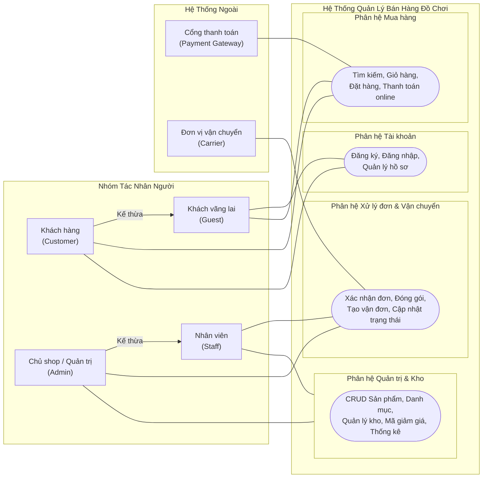
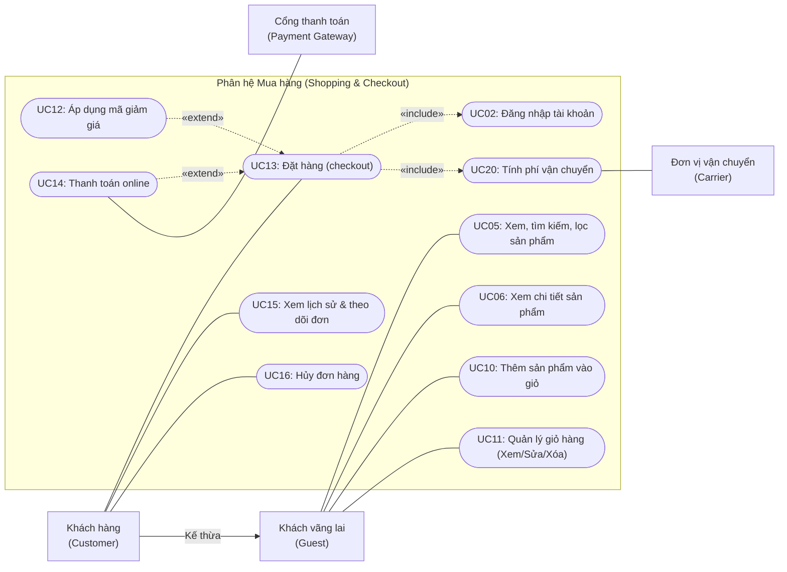
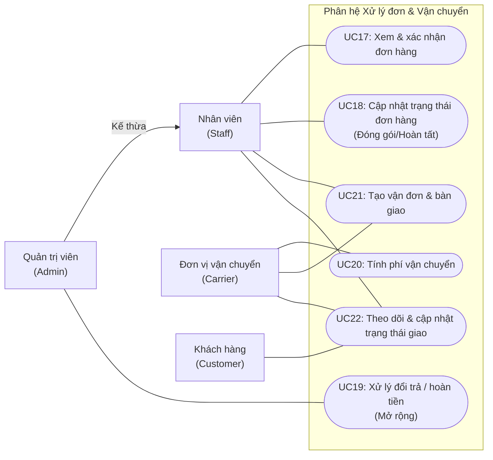
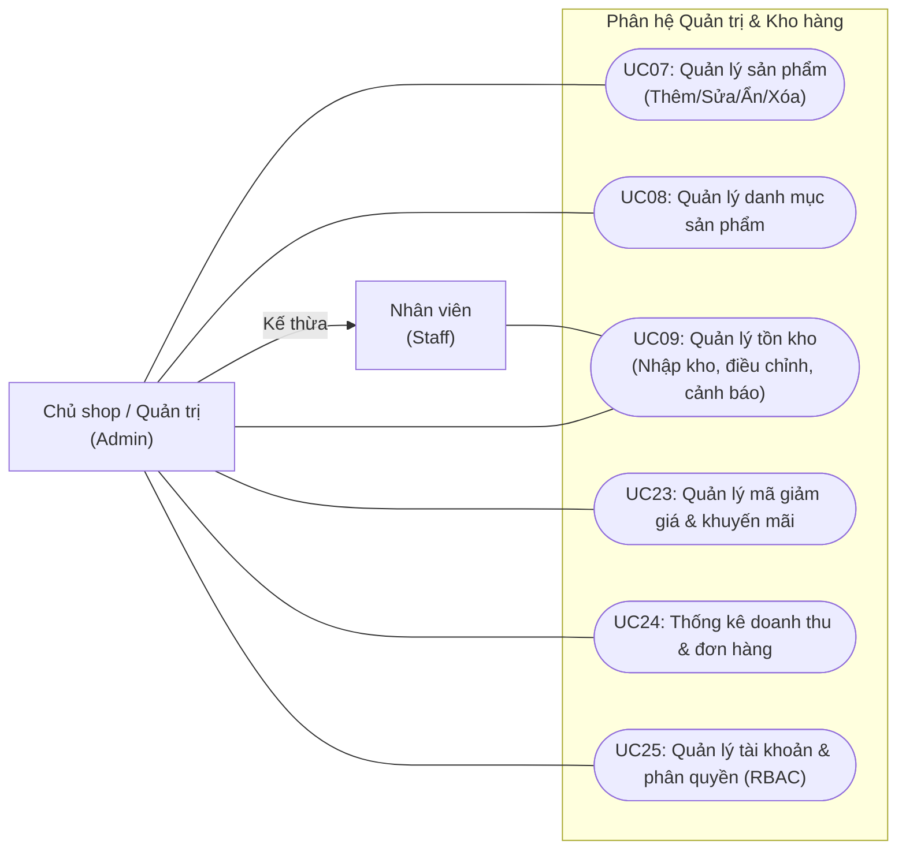

# Use Case Diagram

> **Phụ trách:** Tô Đoàn Khánh Nguyên  
> **Trạng thái:** 🟠 Chờ duyệt  
> **Hạn:** 2026-11-05  

Tài liệu mô hình hóa chức năng bằng **Sơ đồ ca sử dụng (Use Case Diagram - UCD)** cho **Hệ thống quản lý bán hàng trực tuyến cho cửa hàng đồ chơi nhỏ**. Tài liệu gồm 1 sơ đồ tổng quát toàn hệ thống và 3 sơ đồ module phân hệ chi tiết, bảo đảm tính nhất quán với [Quy ước danh mục 25 Use Case](../00_Quyuoc/03_danh_sach_use_case.md) và [Yêu cầu chức năng FR](../02_YeuCau/01_yeu_cau_chuc_nang.md).

---

## 1. Sơ đồ Use Case tổng quát (Toàn hệ thống - 6 Actor)

### Sơ đồ trực quan

### Giải thích sơ đồ tổng quát (3–5 dòng)
* **Tổng thể:** Hệ thống phục vụ 6 Actor, gồm 4 tác nhân con người phân cấp rõ ràng (`Customer` kế thừa toàn bộ quyền của `Guest`, `Admin` kế thừa toàn bộ quyền của `Staff`) và 2 hệ thống dịch vụ bên ngoài kết nối qua giao thức tích hợp (Cổng thanh toán và Đơn vị vận chuyển).
* **Phân định phạm vi:** Khách hàng tương tác chủ yếu ở phân hệ Tra cứu và Mua hàng; Nhân viên tập trung xử lý đơn hàng, đóng gói và phối hợp vận chuyển; Quản trị viên phụ trách cấu hình danh mục, quản lý tồn kho, khuyến mãi và giám sát hiệu quả kinh doanh qua dashboard.

---

## 2. Module Mua hàng (UC05 – UC16)

### Sơ đồ trực quan

### Giải thích Module Mua hàng (3–5 dòng)
* Module bao phủ hành trình của khách từ khi tìm kiếm đồ chơi, chọn giỏ hàng cho đến khi hoàn tất đặt đơn.
* **Điểm then chốt:** Khi thực hiện ca sử dụng trung tâm `UC13 (Đặt hàng)`, hệ thống **bắt buộc phải thực hiện** `UC02 (Đăng nhập)` để xác thực danh tính và `UC20 (Tính phí vận chuyển)` từ đơn vị vận chuyển theo địa chỉ giao («include»).
* Việc nhập mã khuyến mãi `UC12` và thanh toán trực tuyến `UC14` chỉ diễn ra khi khách có mã hoặc lựa chọn phương thức thanh toán online («extend»).

---

## 3. Module Xử lý đơn và vận chuyển (UC17 – UC22)

### Sơ đồ trực quan

### Giải thích Module Xử lý đơn và vận chuyển (3–5 dòng)
* Module này giải quyết triệt để 2 vấn đề lớn được phát hiện trong khâu khảo sát: thất lạc đơn hàng và không đồng bộ với đơn vị vận chuyển bên ngoài.
* Sau khi khách đặt hàng, `Staff` tiến hành duyệt đơn (`UC17`), đóng gói (`UC18`) và khởi tạo vận đơn (`UC21`) để kết nối trực tiếp với `Carrier`.
* Ca sử dụng `UC22` là điểm giao thoa đa bên: `Carrier` gửi webhook/API cập nhật hành trình, `Staff` theo dõi tiến độ giao hàng và `Customer` có thể tra cứu mã tracking thời gian thực.

---

## 4. Module Quản trị và Kho (UC07–UC09, UC23–UC25)

### Sơ đồ trực quan

### Giải thích Module Quản trị (3–5 dòng)
* Phân hệ này tập trung vào các chức năng vận hành nội bộ của cửa hàng đồ chơi nhằm quản lý chặt chẽ hàng hóa và theo dõi dòng tiền.
* `Staff` chỉ được phân quyền thao tác cập nhật kho hàng thực tế (`UC09`).
* `Admin` nắm giữ toàn quyền: vừa có thể làm mọi việc của nhân viên, vừa độc quyền thực hiện quản trị danh mục/sản phẩm (`UC07`, `UC08`), cấu hình coupon (`UC23`), quản trị nhân sự (`UC25`) và theo dõi báo cáo doanh thu (`UC24`).

---

## 5. Phân biệt Include / Extend / Generalization trong đề tài

Đây là nội dung trọng tâm cần nắm vững để trả lời bảo vệ đồ án:

| Khái niệm quan hệ | Bản chất trong UML | Chiều mũi tên | Ví dụ thực tế trong đề tài |
| :--- | :--- | :---: | :--- |
| **Generalization** *(Quan hệ Kế thừa)* | Thể hiện mối quan hệ "is-a" (là một dạng của). Actor con kế thừa toàn bộ các ca sử dụng mà Actor cha có thể kích hoạt, đồng thời có thể có thêm các đặc quyền riêng. | Nét liền, đầu mũi tên tam giác trỏ từ **Con $\rightarrow$ Cha** | • **Customer $\rightarrow$ Guest:** Khách hàng đăng nhập là một dạng khách vãng lai, thừa hưởng toàn bộ quyền xem/tìm đồ chơi của Guest, nhưng có thêm quyền đặt hàng và xem lịch sử đơn. • **Admin $\rightarrow$ Staff:** Chủ cửa hàng thừa hưởng mọi quyền xử lý đơn và kho của Nhân viên, đồng thời có thêm quyền cấu hình giá, nhân sự và báo cáo. |
| **Include** *(Quan hệ Bao hàm / Bắt buộc)* | Thể hiện hành vi **bắt buộc phải thực hiện** như một phần cấu thành không thể thiếu của ca sử dụng gốc. Thiếu ca sử dụng con thì ca sử dụng gốc không thể hoàn thành. | Nét đứt, gắn nhãn `«include»`, trỏ từ **Gốc $\rightarrow$ Con** | • **UC13 (Đặt hàng) $\rightarrow$ UC02 (Đăng nhập):** Nghiệp vụ cửa hàng đồ chơi quy định bắt buộc phải có tài khoản để lưu thông tin và bảo hành, nên đặt hàng bắt buộc phải kèm đăng nhập. • **UC13 (Đặt hàng) $\rightarrow$ UC20 (Tính phí vận chuyển):** Khi đặt hàng luôn luôn phải tính toán cước ship theo địa chỉ giao trước khi ra tổng hóa đơn thanh toán. |
| **Extend** *(Quan hệ Mở rộng / Tùy chọn)* | Thể hiện hành vi **bổ sung có điều kiện**, chỉ được kích hoạt tại các điểm mở rộng (extension points) nhất định. Ca sử dụng gốc vẫn hoàn thành bình thường dù ca sử dụng mở rộng có diễn ra hay không. | Nét đứt, gắn nhãn `«extend»`, trỏ từ **Mở rộng $\rightarrow$ Gốc** *(Quy chuẩn UML)* | • **UC12 (Áp mã giảm giá) $\rightarrow$ UC13 (Đặt hàng):** Khách có thể có voucher hoặc không; việc áp coupon là hành vi tùy chọn không bắt buộc khi checkout. • **UC14 (Thanh toán online) $\rightarrow$ UC13 (Đặt hàng):** Chỉ khi khách hàng chủ động chọn phương thức thanh toán trực tuyến (VNPAY/MoMo mô phỏng) thì luồng gọi cổng thanh toán mới được kích hoạt; nếu khách chọn COD thì ca sử dụng này không diễn ra. |
