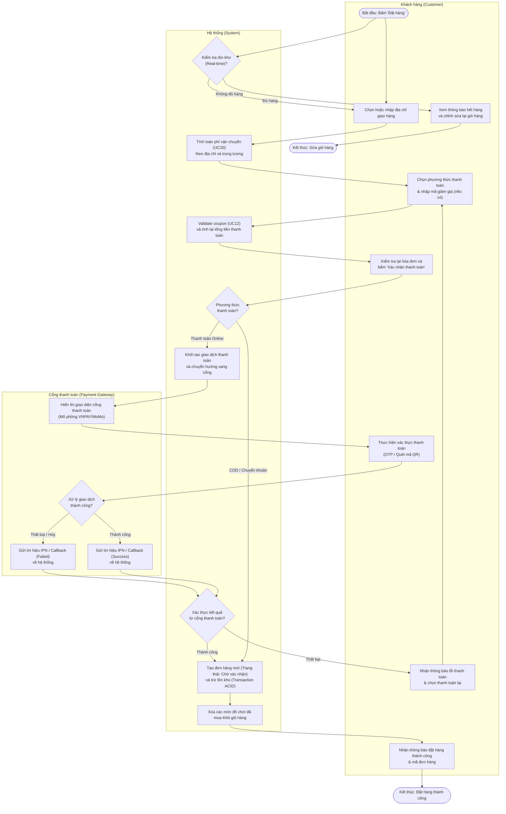

# AD1 – Đặt hàng và thanh toán

> **Phụ trách:** Tô Đoàn Khánh Nguyên  
> **Trạng thái:** 🟠 Chờ duyệt  
> **Hạn:** 2026-11-05  

Tài liệu mô hình hóa luồng công việc của quy trình **Đặt hàng và thanh toán (Checkout & Payment Flow)** thông qua sơ đồ hoạt động phân làn (Activity Diagram with Swimlanes). Sơ đồ thể hiện sự phối hợp nhịp nhàng giữa thao tác người dùng, xử lý logic nội bộ và tích hợp cổng thanh toán trực tuyến.

* **Ca sử dụng liên quan:** `UC13 (Đặt hàng)`, `UC14 (Thanh toán online)`, `UC12 (Áp mã giảm giá)`, `UC20 (Tính phí vận chuyển)`, `UC02 (Đăng nhập)`.
* **Phân chia 3 làn bơi (Swimlanes):**
  1. `Khách hàng (Customer)`: Tác nhân khởi tạo và xác nhận giao dịch.
  2. `Hệ thống (System)`: Xử lý kiểm tra tồn kho, tính cước phí, áp voucher, quản lý giao dịch CSDL.
  3. `Cổng thanh toán (Payment Gateway)`: Hệ thống ngoài chịu trách nhiệm xử lý trừ tiền qua thẻ/ví điện tử.

---

## 1. Sơ đồ hoạt động AD1 (Activity Diagram)

---

## 2. Giải thích sơ đồ hoạt động (Thuyết minh kỹ thuật)

1. **Kiểm tra tồn kho 2 lần (Two-phase checking):** Để triệt tiêu hoàn toàn rủi ro bán vượt tồn kho (overselling), hệ thống kích hoạt kiểm tra tồn kho ngay khi khách bấm đặt hàng và khóa dòng kiểm tra lần cuối ngay trước khi thực thi lệnh trừ kho (`B7`).
2. **Xử lý giao dịch toàn vẹn (ACID):** Bước tạo đơn hàng mới, tạo chi tiết đơn hàng (`ORDER_ITEM`) và trừ số lượng trong bảng `PRODUCT` được đóng gói trong một Database Transaction duy nhất; nếu có bất kỳ sự cố mạng nào xảy ra thì toàn bộ dữ liệu tự động rollback về trạng thái ban đầu.
3. **Rẽ nhánh thanh toán linh hoạt:** Hệ thống phân tách rõ rệt giữa luồng thanh toán trả sau (COD/Chuyển khoản) và trả trước trực tuyến. Nếu thanh toán qua Cổng gặp trục trặc (khách hủy giao dịch, thẻ không đủ số dư), hệ thống không tạo đơn lỗi mà điều hướng khách quay lại bước chọn phương thức khác để tối ưu tỷ lệ chuyển đổi đơn hàng.
