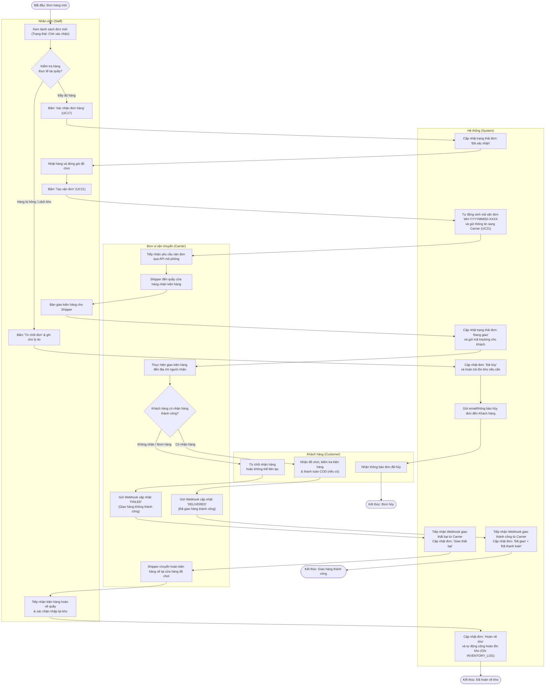

# AD2 – Xử lý đơn và giao hàng

> **Phụ trách:** Tô Đoàn Khánh Nguyên  
> **Trạng thái:** 🟠 Chờ duyệt  
> **Hạn:** 2026-11-05  

Tài liệu mô hình hóa luồng nghiệp vụ **Xử lý đơn hàng nội bộ và Giao nhận với đơn vị vận chuyển (Order Fulfillment & Delivery Flow)** bằng sơ đồ hoạt động phân làn (Activity Diagram with Swimlanes). Luồng này giải quyết bài toán cốt lõi của cửa hàng đồ chơi: chống sót đơn, tự động hóa quy trình vận đơn và kiểm soát hàng hoàn chặt chẽ.

* **Ca sử dụng liên quan:** `UC17 (Xem & xác nhận đơn)`, `UC18 (Cập nhật trạng thái đơn)`, `UC21 (Tạo vận đơn, bàn giao)`, `UC22 (Theo dõi & cập nhật trạng thái giao)`.
* **Phân chia 4 làn bơi (Swimlanes):**
  1. `Nhân viên (Staff)`: Tiếp nhận đơn, kiểm tra kho thực tế, đóng gói, bàn giao cho shipper và xử lý nhận hàng hoàn.
  2. `Hệ thống (System)`: Chuyển đổi trạng thái, sinh mã vận đơn, đồng bộ dữ liệu qua API/Webhook, tự động hoàn tồn kho.
  3. `Đơn vị vận chuyển (Carrier)`: Tiếp nhận thông tin vận đơn, lấy hàng tại shop, thực hiện giao vận và cập nhật trạng thái.
  4. `Khách hàng (Customer)`: Nhận đồ chơi, kiểm tra hàng và thanh toán tiền mặt (nếu là đơn COD).

---

## 1. Sơ đồ hoạt động AD2 (Activity Diagram)

---

## 2. Giải thích sơ đồ hoạt động (Thuyết minh kỹ thuật)

1. **Khắc phục triệt để bài toán sót đơn và lệch kho (As-Is):** Sơ đồ AD2 minh họa rõ cơ chế kiểm soát 2 vòng: Nhân viên kiểm hàng tại chỗ trước khi bấm xác nhận (`S2`), tránh tình trạng khách đã đặt nhưng kho thực tế bị hỏng hoặc thất lạc đồ chơi.
2. **Tự động hóa kết nối với Hãng vận chuyển (Carrier Integration):** Quá trình bàn giao vận đơn được tự động hóa thông qua hệ thống tự sinh mã vận đơn chuẩn hóa (`WH-YYYYMMDD-XXXX`), chuyển tiếp dữ liệu trực tiếp sang hãng vận chuyển và gửi mã tracking cho khách hàng tra cứu theo thời gian thực mà không cần nhân viên ghi chép tay.
3. **Quy trình xử lý ngược (Reverse Logistics / Hàng hoàn):** Luồng xử lý khi giao hàng thất bại được định nghĩa chặt chẽ. Hệ thống chỉ thực hiện hoàn trả số lượng vào bảng tồn kho (`SYS8`) khi nhân viên đã trực tiếp nhận lại kiện hàng vật lý tại cửa hàng và bấm xác nhận (`S8`), ngăn ngừa gian lận hoặc sai lệch số liệu tồn kho.
