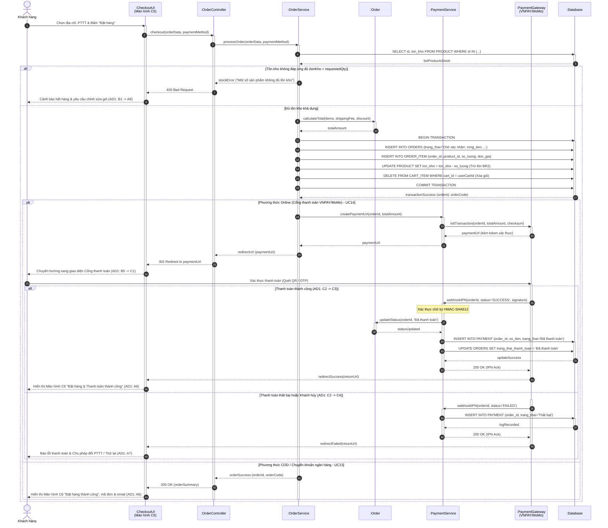

# SD2 – Đặt hàng và thanh toán online (UC13 + UC14)

> **Phụ trách:** Huỳnh Nguyễn Quốc Việt  
> **Trạng thái:** 🟠 Chờ duyệt  
> **Hạn:** —

---

## 1. Sơ đồ tuần tự (Sequence Diagram)

---

## 2. Giải thích sơ đồ (Thuyết minh kỹ thuật)

1. **Mục đích:** Sơ đồ mô hình hóa toàn diện quá trình chốt đơn và xử lý thanh toán, tích hợp liền mạch giữa hai ca sử dụng nòng cốt là `UC13 (Đặt hàng / Checkout)` và `UC14 (Thanh toán online)`.
2. **Khớp 100% với Sơ đồ hoạt động AD1 của Nguyên:**
   - Kiểm tra tồn kho thời gian thực trước khi trừ (`B1` trong `AD1`). Nếu không đủ hàng, chuyển hướng khách sửa giỏ (`A8`).
   - Tạo đơn hàng và trừ kho trong một giao dịch nguyên tử (`B7` trong `AD1` – ACID Transaction).
   - Phân nhánh phương thức thanh toán: Nếu chọn Online Payment (`B4`), hệ thống sinh URL kèm chữ ký số và chuyển tiếp khách sang Cổng thanh toán (`B5 -> C1`).
   - Nhánh kết quả thanh toán: Xử lý thành công (`C3 -> B6 -> A6`) cập nhật trạng thái `"Đã thanh toán"`; xử lý thất bại (`C4 -> A7`) cho phép thử lại hoặc đổi sang COD.
3. **Đảm bảo tính toàn vẹn dữ liệu (`BR2`, `BR3`):** 
   - Số lượng đồ chơi chỉ được trừ trong bảng `PRODUCT` khi toàn bộ đơn hàng và các dòng `ORDER_ITEM` được ghi nhận thành công.
   - Các sản phẩm đã chốt đơn được tự động dọn sạch khỏi bảng `CART_ITEM` (`B8` trong `AD1`).
4. **Bảo mật giao dịch thanh toán:** Tín hiệu Webhook IPN từ cổng thanh toán được xác thực chữ ký bảo mật HMAC-SHA512 trước khi cập nhật CSDL, ngăn chặn giả mạo kết quả thanh toán.

---

## 3. Đối chiếu với Class Diagram của Quang

Bảng đối chiếu đảm bảo sự thống nhất 100% giữa thông điệp trong sơ đồ tuần tự và phương thức trong mô hình lớp [03_class_diagram.md](../03_class_diagram.md):

| Thông điệp trong sơ đồ | Lớp tiếp nhận (Class) | Phương thức trong Class Diagram | Ý nghĩa nghiệp vụ |
| :--- | :--- | :--- | :--- |
| `calculateTotal(items, shippingFee, discount)` | `Order` | `+calculateTotal(): decimal` | Tính tổng tiền phải thanh toán = Tiền hàng + Phí ship – Giảm giá (`FR17`). |
| `updateStatus(orderId, status)` | `Order` | `+updateStatus()` | Cập nhật trạng thái đơn hàng (`ORDERS.trang_thai`) và thanh toán (`trang_thai_thanh_toan`). |
| `initTransaction(...)` / `webhookIPN(...)` | `Payment` | `+pay(): boolean` | Khởi tạo và ghi nhận kết quả xử lý thanh toán trực tuyến (`UC14`). |
| `checkAvailability(...)` | `Product` | `+checkStock(): boolean` | Quét kiểm tra tồn kho lần cuối cho toàn bộ danh sách sản phẩm trước khi tạo đơn (`BR2`). |
| `DELETE FROM CART_ITEM` | `Cart` | `+removeItem()` | Dọn sạch các mặt hàng đã mua thành công khỏi giỏ hàng cá nhân (`UC11`). |
