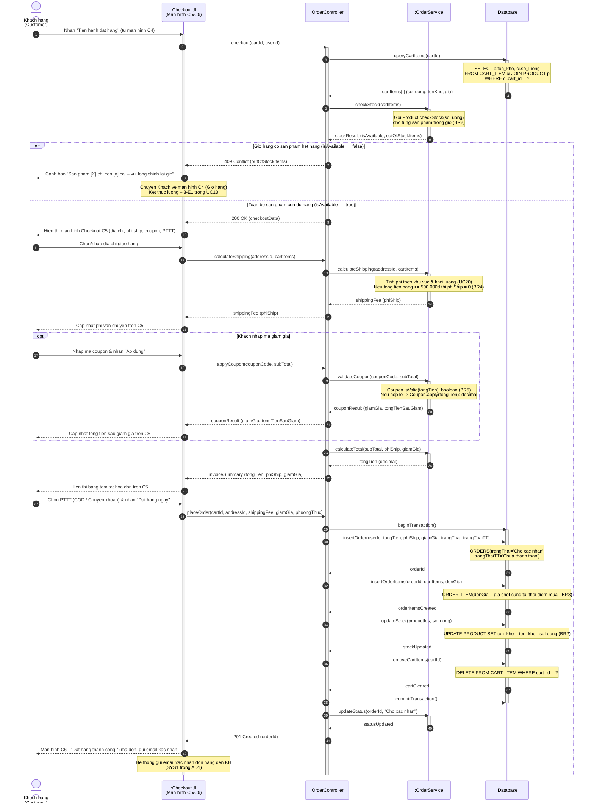
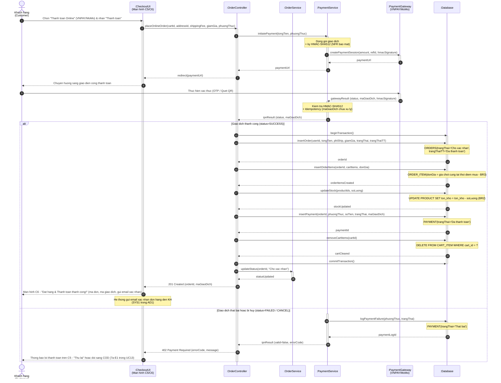

# SD2 – Đặt hàng và Thanh toán online (UC13 + UC14)

> **Phụ trách:** Huỳnh Nguyễn Quốc Việt
> **Trạng thái:** 🟠 Chờ duyệt
> **Hạn:** —

> [!NOTE]
> File SD2 được chia thành **2 sơ đồ tuần tự con (SD2A & SD2B)** để dễ trình bày và tối ưu trực quan, nhưng vẫn nằm trong cùng 1 file theo đúng quy ước `SD1–SD4` của nhóm:
> - **SD2A:** Đặt hàng & Thanh toán khi nhận hàng / Chuyển khoản (UC13).
> - **SD2B:** Thanh toán trực tuyến qua Cổng VNPAY/MoMo (UC14 «extend»).

---

## Sơ đồ 2A – Đặt hàng & Thanh toán khi nhận hàng / Chuyển khoản (UC13)

**Phạm vi:** Khách hàng checkout từ giỏ hàng (C4) → kiểm tra tồn kho vòng 1 (Real-time) → hiển thị Checkout (C5) → tính phí ship (UC20) → áp mã coupon (UC12) → chọn COD/Chuyển khoản → thực thi ACID Transaction (tạo đơn, chốt giá cứng, trừ kho, xóa giỏ) → hiển thị thành công (C6).

---

## Sơ đồ 2B – Thanh toán trực tuyến qua Cổng VNPAY/MoMo (UC14 «extend»)

**Phạm vi:** Khách hàng chọn phương thức Online tại màn hình C5 → hệ thống khởi tạo giao dịch bảo mật HMAC-SHA512 → chuyển hướng sang Cổng thanh toán → khách xác thực OTP/QR → Cổng gọi IPN Webhook về hệ thống → xác thực chữ ký & Idempotency → rẽ nhánh xử lý thành công hoặc thất bại.

---

## Giải thích sơ đồ (Thuyết minh kỹ thuật)

1. **Kiểm tra tồn kho 2 vòng (`BR2`):** Hệ thống thực hiện kiểm tra tồn kho ngay khi mở màn hình Checkout (vòng 1 – `checkStock()`) và chốt khóa dòng lần cuối bên trong Transaction ACID trước khi trừ kho (vòng 2 – `updateStock()`), triệt tiêu hoàn toàn rủi ro bán vượt tồn kho đồng thời (overselling).
2. **Rẽ nhánh phương thức thanh toán (`BR6`):**
   - **SD2A (COD/Chuyển khoản):** Tạo đơn ngay với `trangThaiTT = 'Chưa thanh toán'` và nhân viên đối soát thực tế tại quầy/kho ở UC17.
   - **SD2B (Online):** Kích hoạt UC14 (chuyển hướng → cổng thanh toán → nhận IPN Webhook → xác thực HMAC-SHA512 → kiểm tra Idempotent).
3. **Giao dịch ACID (`FR22`):** Toàn bộ thao tác `insertOrder` → `insertOrderItems` → `updateStock` → `removeCartItems` (và `insertPayment` ở SD2B) được bọc trong một Transaction duy nhất; nếu xảy ra lỗi ở bất kỳ bước nào, hệ thống tự `ROLLBACK` – không để dữ liệu ở trạng thái nửa vời.
4. **Chốt giá tại thời điểm mua (`BR3`):** Giá trị `donGia` trong `ORDER_ITEM` được lấy từ `PRODUCT.gia` tại chính thời điểm thực thi Transaction, không bị thay đổi dù giá sản phẩm có biến động sau này.
5. **Bảo mật thanh toán online (NFR):** Mọi gói tin gửi đến `PaymentGateway` đều được ký bằng HMAC-SHA512. Khi nhận IPN Webhook, `PaymentService` kiểm tra chữ ký và cơ chế Idempotency (`ma_giao_dich` đã xử lý chưa) trước khi cho phép cập nhật đơn hàng, chống tấn công replay và duplicate webhook.

---

## Đối chiếu với Class Diagram của Quang

Bảng đối chiếu đảm bảo thống nhất 100% giữa thông điệp trong sơ đồ tuần tự và phương thức trong mô hình lớp [03_class_diagram.md](../03_class_diagram.md):

| Thông điệp trong sơ đồ | Lớp tiếp nhận (Class) | Phương thức trong Class Diagram | Ý nghĩa nghiệp vụ |
| :--- | :--- | :--- | :--- |
| `checkStock(soLuong)` | `Product` | `+checkStock(soLuong): boolean` | Kiểm tra từng sản phẩm trong giỏ còn đủ tồn kho không (`BR2`). |
| `isValid(tongTien)` | `Coupon` | `+isValid(tongTien): boolean` | Kiểm tra mã giảm giá còn hạn, đủ điều kiện đơn tối thiểu (`BR5`). |
| `apply(tongTien)` | `Coupon` | `+apply(tongTien): decimal` | Tính số tiền chiết khấu thực tế sau khi mã hợp lệ (`BR5`). |
| `calculateTotal(subTotal, phiShip, giamGia)` | `Order` | `+calculateTotal(): decimal` | Tổng hợp `tongTienHang + phiShip - giamGia` thành tổng thanh toán cuối. |
| `pay()` | `Payment` | `+pay(): boolean` | Kích hoạt giao dịch tại cổng thanh toán, trả về trạng thái thành công / thất bại (UC14). |
| `updateStatus(orderId, trangThai)` | `Order` | `+updateStatus(trangThai): void` | Cập nhật trạng thái đơn hàng sau khi tạo đơn hoặc IPN Webhook xác thực thành công. |
| `updateStock(productIds, soLuong)` | `Product` | `+updateStock(delta): void` | Trừ số lượng tồn kho trong bảng `PRODUCT` ngay khi đơn hàng được tạo thành công (`BR2`). |
| `removeCartItems(cartId)` | `Cart` | `+removeItem(sp): void` | Xóa các `CART_ITEM` đã mua khỏi giỏ hàng sau khi tạo đơn thành công. |
