# SD3 – Xác nhận đơn và tạo vận đơn (UC17 + UC21)

> **Phụ trách:** Huỳnh Nguyễn Quốc Việt
> **Trạng thái:** 🟠 Chờ duyệt
> **Hạn:** —

---

## 1. Sơ đồ tuần tự (Sequence Diagram)

```mermaid
sequenceDiagram
    autonumber
    actor Staff as Nhan vien<br/>(Staff/Admin)
    participant UI as :OrderUI<br/>(Man hinh A3/A4)
    participant Ctrl as :OrderController
    participant OrdSvc as :OrderService
    participant ShipSvc as :ShipmentService
    participant Carrier as :CarrierAPI<br/>(GHN/GHTK)
    participant DB as :Database

    %% ============================================================
    %% PHẦN 1 – UC17: XEM VÀ XÁC NHẬN ĐƠN HÀNG
    %% ============================================================

    %% BƯỚC 1: Nhân viên mở danh sách đơn chờ xác nhận
    Staff->>UI: Mo muc "Quan ly don hang" (tab "Cho xac nhan")
    activate UI
    UI->>Ctrl: getOrderList(trangThai="Cho xac nhan")
    activate Ctrl
    Ctrl->>DB: queryOrders(trangThai="Cho xac nhan")
    activate DB
    Note over DB: SELECT * FROM ORDERS<br/>WHERE trang_thai = 'Cho xac nhan'<br/>ORDER BY ngay_tao DESC
    DB-->>Ctrl: orderList[ ] (ma don, ten KH, tong tien, PTTT)
    deactivate DB
    Ctrl-->>UI: 200 OK (orderList)
    UI-->>Staff: Hien thi man hinh A3 (danh sach don "Cho xac nhan")

    %% BƯỚC 2: Nhân viên mở chi tiết một đơn hàng
    Staff->>UI: Nhan vao don hang de xem chi tiet
    UI->>Ctrl: getOrderDetail(orderId)
    Ctrl->>DB: queryOrderDetail(orderId)
    activate DB
    Note over DB: SELECT o.*, oi.*, p.ten, p.gia<br/>FROM ORDERS o JOIN ORDER_ITEM oi<br/>JOIN PRODUCT p WHERE o.id = orderId
    DB-->>Ctrl: orderDetail (san pham, dia chi, PTTT, trang_thai_tt)
    deactivate DB
    Ctrl-->>UI: 200 OK (orderDetail)
    UI-->>Staff: Hien thi man hinh A4 (chi tiet don hang)

    %% BƯỚC 3: Nhân viên kiểm tra hàng thực tế → rẽ nhánh (S2 trong AD2)
    Note over Staff: Kiem tra hang thuc te tai quay (S2 trong AD2):<br/>dam bao do choi nguyen ven, du so luong

    alt Hang du & dat chuan – Xac nhan don (UC17 Main Flow)

        Staff->>UI: Nhan "Xac nhan don hang" tren A4
        UI->>Ctrl: confirmOrder(orderId, staffId)
        Ctrl->>DB: checkOrderStatus(orderId)
        activate DB
        Note over DB: Kiem tra ORDERS.trang_thai = 'Cho xac nhan'<br/>(chong xung dot dong thoi - 6-E1 UC17)
        DB-->>Ctrl: currentStatus
        deactivate DB

        Ctrl->>OrdSvc: updateStatus(orderId, "Da xac nhan")
        activate OrdSvc
        Ctrl->>DB: updateOrderStatus(orderId, trangThai, staffId, thoiGian)
        activate DB
        Note over DB: UPDATE ORDERS SET trang_thai='Da xac nhan',<br/>ma_nv_duyet=staffId, thoi_gian_duyet=NOW()
        DB-->>Ctrl: updateSuccess
        deactivate DB
        OrdSvc-->>Ctrl: statusUpdated
        deactivate OrdSvc

        Ctrl-->>UI: 200 OK (trangThai="Da xac nhan")
        UI-->>Staff: Cap nhat A4 – nhan "Da xac nhan", mo nut "Bat dau dong goi"
        Note over UI: He thong gui email xac nhan den KH (SYS3 trong AD2)

    else Hang hong / Lech kho – Tu choi don (UC17 Alt Flow 6a)

        Staff->>UI: Nhan "Tu choi don" & nhap ly do
        UI->>Ctrl: rejectOrder(orderId, staffId, lyDo)
        Ctrl->>OrdSvc: updateStatus(orderId, "Da huy")
        activate OrdSvc

        %% ACID Transaction: Hủy đơn + Hoàn tồn kho (BR2)
        Ctrl->>DB: beginTransaction()
        activate DB
        Ctrl->>DB: updateOrderStatus(orderId, "Da huy", lyDo)
        Note over DB: UPDATE ORDERS SET trang_thai='Da huy', ly_do_huy=lyDo
        DB-->>Ctrl: orderCancelled

        Ctrl->>DB: restoreStock(orderItems)
        Note over DB: UPDATE PRODUCT SET ton_kho = ton_kho + so_luong<br/>cho tung san pham trong ORDER_ITEM (BR2)
        DB-->>Ctrl: stockRestored

        Ctrl->>DB: insertInventoryLog(orderItems, lyDo)
        Note over DB: INSERT INTO INVENTORY_LOG<br/>(ly_do='Huy don / Hong hang', bien_dong=+soLuong)
        DB-->>Ctrl: logCreated

        Ctrl->>DB: commitTransaction()
        deactivate DB

        OrdSvc-->>Ctrl: statusUpdated
        deactivate OrdSvc

        Ctrl-->>UI: 200 OK (trangThai="Da huy")
        UI-->>Staff: Cap nhat A4 – nhan "Da huy"
        Note over UI: He thong gui email huy don & ly do den KH (SYS1-SYS2 trong AD2)

    end
    deactivate Ctrl

    %% ============================================================
    %% PHẦN 2 – UC21: TẠO VẬN ĐƠN VÀ BÀN GIAO SHIPPER
    %% ============================================================

    Note over Staff,DB: -- Nhan vien hoan tat dong goi do choi (UC18) --<br/>Don hang o trang thai "Da xac nhan" / "Dang dong goi"

    %% BƯỚC 4: Nhân viên mở form tạo vận đơn
    Staff->>UI: Nhan "Tao van don" tren A4
    UI->>Ctrl: initShipmentForm(orderId)
    activate Ctrl
    Ctrl->>DB: queryShipmentPrerequisite(orderId)
    activate DB
    Note over DB: Kiem tra:<br/>1. trang_thai IN ('Da xac nhan','Dang dong goi')<br/>2. Neu PTTT=Online: trang_thai_tt='Da thanh toan'<br/>3. Chua co ban ghi SHIPMENT
    DB-->>Ctrl: prerequisiteOK (orderInfo, addressInfo, tienCOD)
    deactivate DB
    Ctrl-->>UI: 200 OK (shipmentFormData)
    UI-->>Staff: Hien thi form tao van don (carrier, trong luong, COD, ghi chu)

    %% BƯỚC 5: Nhân viên chọn carrier và xác nhận tạo vận đơn
    Staff->>UI: Chon carrier (GHN/GHTK), kiem tra thong so, nhan "Xac nhan tao van don"
    UI->>Ctrl: createShipment(orderId, carrierId, shipmentParams)

    %% Hệ thống tự sinh mã vận đơn WH-YYYYMMDD-XXXX (FR26 / SYS4 trong AD2)
    Ctrl->>ShipSvc: generateTrackingCode(orderId)
    activate ShipSvc
    Note over ShipSvc: Sinh ma van don: WH-YYYYMMDD-XXXX<br/>(WH=tien to kho, YYYYMMDD=ngay tao,<br/>XXXX=so thu tu tang dan trong ngay - FR26)
    ShipSvc-->>Ctrl: maVanDon (WH-YYYYMMDD-XXXX)
    deactivate ShipSvc

    %% Gửi sang Carrier API (C1 trong AD2)
    Ctrl->>Carrier: registerShipment(maVanDon, addressInfo, shipmentParams, tienCOD)
    activate Carrier
    Note over Carrier: Carrier xac thuc tuyen giao, kiem tra dia chi<br/>va tien thu ho COD (5-E1/5-E2 trong UC21)

    alt Carrier chap nhan van don (status=200)

        Carrier-->>Ctrl: 200 OK (carrierShipmentId, estimatedDelivery)
        deactivate Carrier

        %% Lưu bản ghi SHIPMENT vào DB
        Ctrl->>ShipSvc: createShipment()
        activate ShipSvc
        Ctrl->>DB: insertShipment(orderId, carrierId, maVanDon, phi, trangThai, tienCOD)
        activate DB
        Note over DB: INSERT INTO SHIPMENT<br/>(order_id, carrier_id, ma_van_don,<br/>phi, trang_thai='Cho lay hang', tien_cod)
        DB-->>Ctrl: shipmentId
        deactivate DB
        ShipSvc-->>Ctrl: shipmentCreated
        deactivate ShipSvc

        Ctrl-->>UI: 201 Created (shipmentId, maVanDon)
        UI-->>Staff: Hien thi phieu van don & nut "In phieu giao hang"
        Note over UI: Xuat Shipping Label (barcode + QR) de in dan len kien hang

        %% BƯỚC 6: Bàn giao Shipper
        Note over Staff: Shipper den quan nhan kien hang (C2 trong AD2)
        Staff->>UI: Nhan "Ban giao cho Shipper" tren A4
        UI->>Ctrl: handoverToShipper(orderId, shipmentId)
        Ctrl->>OrdSvc: updateStatus(orderId, "Dang giao")
        activate OrdSvc
        Ctrl->>DB: updateHandoverStatus(orderId, shipmentId)
        activate DB
        Note over DB: UPDATE SHIPMENT SET trang_thai='Dang van chuyen'<br/>UPDATE ORDERS SET trang_thai='Dang giao'
        DB-->>Ctrl: handoverDone
        deactivate DB
        OrdSvc-->>Ctrl: statusUpdated
        deactivate OrdSvc
        Ctrl-->>UI: 200 OK (trangThai="Dang giao")
        UI-->>Staff: Cap nhat A4 – "Dang giao", hien ma tracking
        Note over UI: He thong gui email + ma tracking cho KH (SYS5 trong AD2)

    else Carrier tu choi (Timeout / Dia chi loi / Qua tai trong)

        Ctrl-->>UI: 502 Bad Gateway (errorCode, message)
        UI-->>Staff: Thong bao loi Carrier: "Thu lai hoac doi carrier khac"
        Note over UI: Don giu nguyen trang thai "Da xac nhan"<br/>Nhan vien co the thu lai hoac chon carrier khac (5-E1/5-E2/5-E3 trong UC21)

    end

    deactivate Ctrl
    deactivate UI
```

---

## 2. Giải thích sơ đồ (Thuyết minh kỹ thuật)

1. **Kết hợp UC17 + UC21 theo đúng luồng AD2:** Sơ đồ chia làm 2 phần liền mạch – Phần 1 mô hình hóa quy trình nhân viên xem và ra quyết định đối với đơn hàng (UC17): xác nhận chuyển sang `'Đã xác nhận'` hoặc từ chối kèm hoàn tồn kho ACID; Phần 2 tiếp nối từ trạng thái `'Đã xác nhận'` để tạo vận đơn và bàn giao Shipper (UC21).
2. **ACID Transaction khi từ chối đơn (`BR2`):** Toàn bộ thao tác `updateOrder(hủy)` → `restoreStock()` → `insertInventoryLog()` được bọc trong một Database Transaction duy nhất, đảm bảo tồn kho được hoàn trả chính xác và có nhật ký `INVENTORY_LOG` ngay cả khi hệ thống gặp sự cố giữa chừng.
3. **Sinh mã vận đơn tự động (`FR26`):** `ShipmentService.generateTrackingCode()` tạo mã chuẩn hóa `WH-YYYYMMDD-XXXX` nội bộ trước khi gửi sang Carrier API – khớp với bước `SYS4` trong AD2 của Nguyên và phương thức `Shipment.createShipment()` trong Class Diagram của Quang.
4. **Kiểm tra tiền điều kiện tạo vận đơn:** Hệ thống bắt buộc kiểm tra 3 điều kiện trước khi cho phép tạo vận đơn: (a) đơn ở trạng thái hợp lệ, (b) đơn thanh toán online phải có `trang_thai_tt = 'Đã thanh toán'` (chống tạo vận đơn khi chưa thu tiền), (c) chưa có bản ghi `SHIPMENT` tồn tại (chống tạo trùng vận đơn).
5. **Rẽ nhánh Carrier:** Sơ đồ xử lý rõ nhánh lỗi API Carrier (timeout/địa chỉ sai/quá tải trọng) – đơn hàng giữ nguyên trạng thái, nhân viên có thể thử lại hoặc đổi carrier, không gây mất dữ liệu.

---

## 3. Đối chiếu với Class Diagram của Quang

Bảng đối chiếu đảm bảo thống nhất 100% giữa thông điệp trong sơ đồ tuần tự và phương thức trong mô hình lớp [03_class_diagram.md](../03_class_diagram.md):

| Thông điệp trong sơ đồ | Lớp tiếp nhận (Class) | Phương thức trong Class Diagram | Ý nghĩa nghiệp vụ |
| :--- | :--- | :--- | :--- |
| `updateStatus(orderId, trangThai)` | `Order` | `+updateStatus(trangThai): void` | Chuyển trạng thái đơn hàng: `'Chờ xác nhận'` → `'Đã xác nhận'` hoặc `'Đã hủy'` (UC17). |
| `cancel()` | `Order` | `+cancel(): void` | Hủy đơn hàng khi nhân viên từ chối, kích hoạt hoàn tồn kho (`BR2`). |
| `updateStock(delta)` | `Product` | `+updateStock(delta): void` | Hoàn trả số lượng tồn kho vào `PRODUCT` khi đơn bị hủy (`delta = +soLuong`). |
| `createShipment()` | `Shipment` | `+createShipment(): void` | Khởi tạo bản ghi vận đơn trong bảng `SHIPMENT` với mã `WH-YYYYMMDD-XXXX` (UC21). |
| `track()` | `Shipment` | `+track(): String` | Trả về mã vận đơn và trạng thái giao hàng để hiển thị cho nhân viên và khách hàng. |
| `updateStatus(orderId, "Dang giao")` | `Order` | `+updateStatus(trangThai): void` | Cập nhật trạng thái đơn sang `'Đang giao'` sau khi bàn giao Shipper thành công. |
