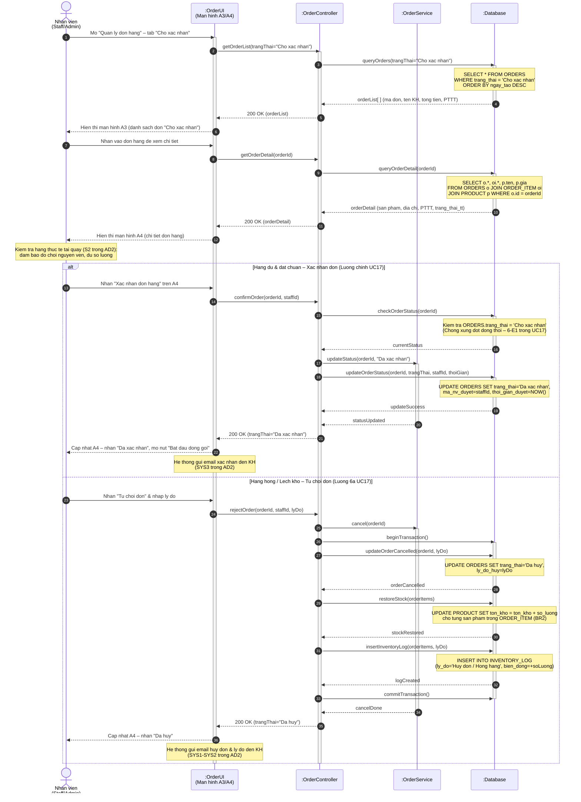
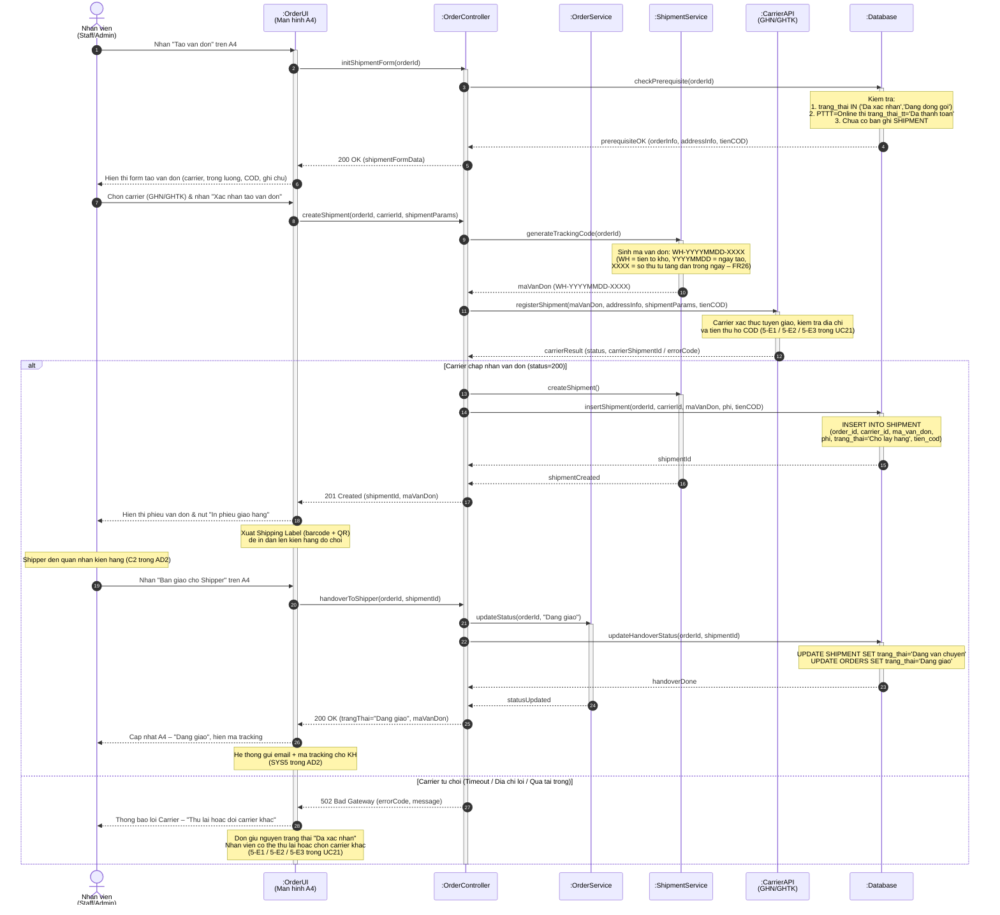

# SD3 – Xác nhận đơn và tạo vận đơn (UC17 + UC21)

> **Phụ trách:** Huỳnh Nguyễn Quốc Việt
> **Trạng thái:** 🟠 Chờ duyệt
> **Hạn:** —

> [!NOTE]
> File SD3 được chia thành **2 sơ đồ tuần tự con (SD3a & SD3b)** để dễ trình bày, nhưng vẫn nằm trong cùng 1 file theo đúng quy ước `SD1–SD4` của nhóm. Hai sơ đồ nối tiếp nhau qua trạng thái trung gian `'Đã xác nhận'` sau khi nhân viên hoàn tất đóng gói (`UC18`).

---

## Sơ đồ 3A – Xem & Xác nhận đơn hàng (UC17)

**Phạm vi:** Nhân viên tra cứu danh sách đơn → kiểm tra hàng thực tế → xác nhận duyệt hoặc từ chối đơn kèm hoàn tồn kho ACID.

**→ Tiếp theo:** Nhân viên nhặt hàng & đóng gói (`UC18`), sau đó kích hoạt **SD3B** để tạo vận đơn.

---

## Giải thích SD3A (Thuyết minh kỹ thuật)

1. **Tải đơn hàng 2 bước:** Hệ thống hiển thị danh sách tóm tắt trên A3 trước, chỉ truy vấn chi tiết (`ORDER_ITEM`, `PRODUCT`, địa chỉ) khi nhân viên mở một đơn cụ thể trên A4 – giảm tải DB và tăng tốc màn hình danh sách.
2. **Chống xung đột đồng thời (Optimistic Locking):** Trước khi cập nhật, hệ thống đọc lại `ORDERS.trang_thai` từ DB (không dùng cache) để phát hiện trường hợp 2 nhân viên cùng duyệt 1 đơn – khớp ngoại lệ 6-E1 trong UC17.
3. **ACID Transaction khi hủy đơn (`BR2`):** Toàn bộ `updateOrder(hủy)` → `updateStock(+delta)` → `insertInventoryLog()` được bọc trong 1 Transaction duy nhất; nếu xảy ra lỗi ở bất kỳ bước nào thì `ROLLBACK` hoàn toàn, không để tồn kho ở trạng thái nửa vời.

---

## Đối chiếu SD3A với Class Diagram của Quang

| Thông điệp trong sơ đồ | Lớp tiếp nhận (Class) | Phương thức trong Class Diagram | Ý nghĩa nghiệp vụ |
| :--- | :--- | :--- | :--- |
| `updateStatus(orderId, "Da xac nhan")` | `Order` | `+updateStatus(trangThai): void` | Chuyển đơn sang `'Đã xác nhận'` sau khi nhân viên duyệt. |
| `cancel(orderId)` | `Order` | `+cancel(): void` | Hủy đơn và kích hoạt hoàn tồn kho (`BR2`). |
| `updateStock(delta)` via `restoreStock()` | `Product` | `+updateStock(delta): void` | Hoàn trả số lượng tồn kho (`delta = +soLuong`) khi đơn bị từ chối. |

---
---

## Sơ đồ 3B – Tạo vận đơn & Bàn giao Shipper (UC21)

**Phạm vi:** Nhân viên tạo vận đơn sau khi đóng gói → hệ thống sinh mã `WH-YYYYMMDD-XXXX` → gửi Carrier API → bàn giao Shipper, đơn chuyển sang `'Đang giao'`.

> [!IMPORTANT]
> **Tiền điều kiện bắt buộc:** Đơn hàng phải ở trạng thái `'Đã xác nhận'` hoặc `'Đang đóng gói'`. Nếu đơn thanh toán online thì `trang_thai_tt = 'Đã thanh toán'` (chống tạo vận đơn khi chưa thu tiền).

---

## Giải thích SD3B (Thuyết minh kỹ thuật)

1. **Kiểm tra tiền điều kiện 3 lớp:** Trước khi hiển thị form tạo vận đơn, hệ thống kiểm tra đồng thời: (a) trạng thái đơn hợp lệ, (b) đơn thanh toán online đã thu tiền (`trang_thai_tt = 'Đã thanh toán'` – chống tạo vận đơn khi chưa thu tiền, `BR6`), (c) chưa tồn tại bản ghi `SHIPMENT` liên kết (chống tạo vận đơn trùng lặp).
2. **Sinh mã vận đơn tự động (`FR26`):** `ShipmentService.generateTrackingCode()` tạo mã nội bộ chuẩn hóa `WH-YYYYMMDD-XXXX` trước khi chuyển sang Carrier API – khớp bước `SYS4` trong AD2 của Nguyên.
3. **Rẽ nhánh Carrier:** Kết quả API Carrier được xử lý trước `alt` (Carrier trả về rồi mới rẽ nhánh theo `status`) đảm bảo `activate/deactivate` cân bằng. Nhánh lỗi giữ nguyên trạng thái đơn, nhân viên có thể thử lại hoặc đổi carrier mà không mất dữ liệu.
4. **Toàn vẹn tiền thu hộ COD (`BR6`):** Giá trị `tienCOD` trong vận đơn được tự động tính từ tiền điều kiện: `tienCOD = tongTien` với COD, `tienCOD = 0đ` với đơn đã thanh toán online – triệt tiêu rủi ro Shipper thu tiền trùng.

---

## Đối chiếu SD3B với Class Diagram của Quang

| Thông điệp trong sơ đồ | Lớp tiếp nhận (Class) | Phương thức trong Class Diagram | Ý nghĩa nghiệp vụ |
| :--- | :--- | :--- | :--- |
| `createShipment()` | `Shipment` | `+createShipment(): void` | Khởi tạo bản ghi vận đơn trong `SHIPMENT` với mã `WH-YYYYMMDD-XXXX` và trạng thái `'Chờ lấy hàng'`. |
| `track()` | `Shipment` | `+track(): String` | Trả về mã vận đơn và trạng thái để hiển thị cho nhân viên và gửi link tracking cho khách. |
| `updateStatus(orderId, "Dang giao")` | `Order` | `+updateStatus(trangThai): void` | Cập nhật đơn hàng sang `'Đang giao'` sau khi bàn giao Shipper thành công (SYS5 trong AD2). |
