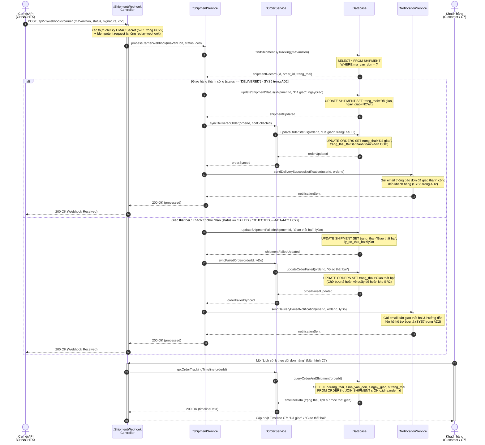

# SD4 – Cập nhật trạng thái giao hàng (UC22)

> **Phụ trách:** Huỳnh Nguyễn Quốc Việt  
> **Trạng thái:** 🟢 Đã hoàn thành  
> **Hạn:** —

---

## 1. Giới thiệu sơ đồ tuần tự SD4

Sơ đồ tuần tự **SD4** mô tả quá trình **Đơn vị vận chuyển (Carrier API – GHN/GHTK)** gọi Webhook Callback ngược về hệ thống để cập nhật hành trình bưu kiện đồ chơi theo thời gian thực (Real-time Tracking), đồng bộ trạng thái đơn hàng (`ORDERS`) và vận đơn (`SHIPMENT`), tự động đối soát công nợ COD, gửi email thông báo và hiển thị tiến trình trên màn hình `C7` cho Khách hàng.

---

## 2. Giải thích SD4 (Thuyết minh kỹ thuật)

1. **Cơ chế Webhook Bất đồng bộ (Asynchronous Callback):** Hệ thống không cần thực hiện polling liên tục làm quá tải API của bên thứ 3. Thay vào đó, Carrier chủ động gửi tín hiệu HTTP POST đến endpoint `/api/v1/webhooks/carrier` mỗi khi Shipper phát kiện hàng thành công hoặc phát sinh sự cố tại địa chỉ nhận.
2. **Xác thực an ninh & Idempotency (`5-E1`, `5-E2` trong UC22):** `ShipmentWebhookController` kiểm tra chữ ký `HMAC Secret Key` nhằm triệt tiêu rủi ro giả mạo trạng thái bưu kiện. Đồng thời, cơ chế kiểm tra trạng thái hiện tại giúp xử lý an toàn các gói tin retry lặp lại từ đơn vị bưu chính mà không cập nhật CSDL hay thanh toán trùng lặp.
3. **Toàn vẹn đối soát công nợ COD:** Khi đơn hàng thuộc diện COD được phát thành công, hệ thống tự động đổi `ORDERS.trang_thai_thanh_toan = 'Đã thanh toán'`, đồng bộ đối soát tiền thu hộ với bưu cục mà không cần nhân viên kế toán can thiệp thủ công.
4. **Phân định hoàn hàng an toàn (`BR2`):** Khi giao thất bại (`status=FAILED`), hệ thống chỉ cập nhật đơn sang `'Giao thất bại'`. Việc hoàn tồn kho đồ chơi (`PRODUCT.ton_kho`) chỉ được kích hoạt khi bưu tá đã mang kiện hàng vật lý về quầy và nhân viên bấm xác nhận tại màn hình `A4` (khớp hoàn toàn bước `S8` trong `AD2` của Nguyên).

---

## 3. Đối chiếu SD4 với Class Diagram của Quang

| Thông điệp trong sơ đồ | Lớp tiếp nhận (Class) | Phương thức trong Class Diagram | Ý nghĩa nghiệp vụ |
| :--- | :--- | :--- | :--- |
| `updateShipmentStatus()` / `updateShipmentFailed()` | `Shipment` | `+track(): String` | Cập nhật mốc hành trình và trạng thái vận đơn trong bảng `SHIPMENT`. |
| `updateOrderStatus("Đã giao")` | `Order` | `+updateStatus(trangThai): void` | Chuyển trạng thái đơn sang `'Đã giao'` khi nhận được tín hiệu phát thành công từ bưu tá. |
| `updateOrderFailed("Giao thất bại")` | `Order` | `+updateStatus(trangThai): void` | Ghi nhận đơn hàng giao thất bại và chờ xử lý chuyển hoàn. |
| `queryOrderAndShipment(orderId)` | `Order` | `+calculateTotal(): double` | Nạp dữ liệu đơn hàng và lịch sử vận chuyển để hiển thị Timeline chi tiết cho khách trên màn hình `C7`. |
