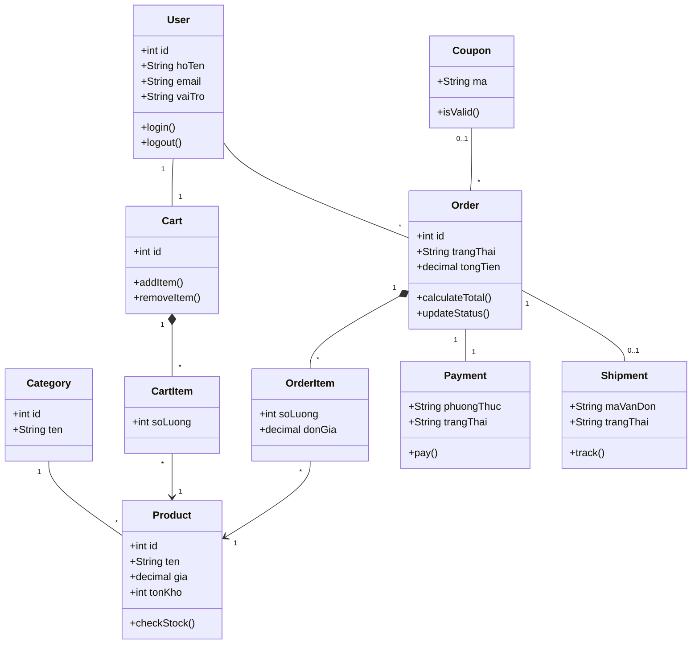
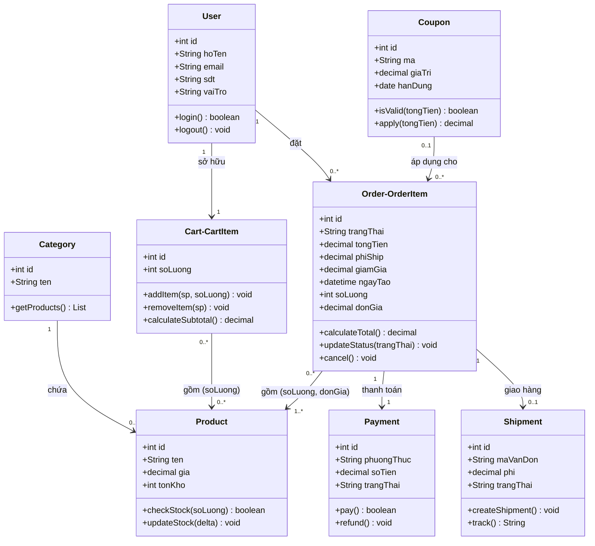

# Class Diagram (8 lớp lõi)

> **Phụ trách:** Trần Vinh Quang  
> **Trạng thái:** 🔴 Chưa làm  
> **Hạn:** —

<!-- huong-dan:start -->
> 💡 Vẽ **Class Diagram rút gọn 8 lớp lõi**: User, Product, Category, Cart–CartItem, Order–OrderItem, Payment, Shipment, Coupon. Mỗi lớp có thuộc tính + 2–3 phương thức và multiplicity. Phương thức đã chốt trong kế hoạch: `Cart.addItem()`, `Order.calculateTotal()`, `Order.updateStatus()`, `Shipment.track()`.
> Bản nháp Mermaid dưới đây chỉ là **điểm xuất phát** (GitHub hiển thị được); hãy chỉnh rồi vẽ lại bằng draw.io và xuất PNG vào `hinh/`. Tên phương thức phải thống nhất với Việt (Sequence).

<!-- huong-dan:end -->

## Sơ đồ

## Danh sách lớp và ánh xạ sang bảng

| Lớp | Thuộc tính chính | Phương thức | Ánh xạ bảng ERD |
| --- | --- | --- | --- |
| User | id, hoTen, email, sdt, vaiTro (Guest/Customer/Staff/Admin) | login(), logout() | USER, ADDRESS |
| Product | id, ten, gia, tonKho | checkStock(soLuong), updateStock(delta) | PRODUCT, PRODUCT_IMAGE |
| Category | id, ten | getProducts() | CATEGORY |
| Cart – CartItem | Cart: id CartItem: soLuong | addItem(sp, soLuong), removeItem(sp), calculateSubtotal() | CART, CART_ITEM |
| Order – OrderItem | Order: id, trangThai, tongTien, phiShip, giamGia, ngayTao OrderItem: soLuong, donGia (giá tại thời điểm mua) | calculateTotal(), updateStatus(trangThai), cancel() | ORDERS, ORDER_ITEM |
| Payment | id, phuongThuc (COD / chuyển khoản / cổng mô phỏng), soTien, trangThai | pay(), refund() | PAYMENT |
| Shipment | id, maVanDon, phi, trangThai | createShipment(), track() | SHIPMENT, CARRIER |
| Coupon | id, ma, giaTri, hanDung | isValid(tongTien), apply(tongTien) | COUPON |

## Giải thích

- Quan hệ Association / Aggregation / Composition / Generalization đã dùng và lý do: TODO
- Cách User thể hiện vai trò (kế thừa Customer/Staff/Admin hay thuộc tính `vai_tro`) và vì sao: TODO
