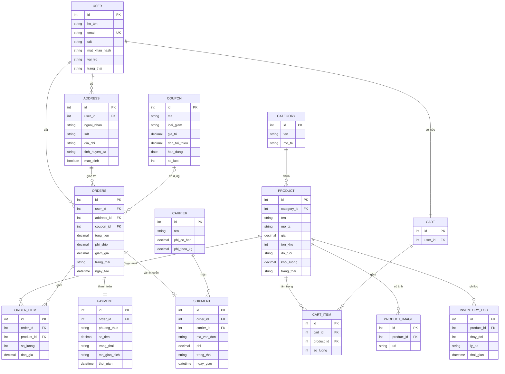

# ERD (14 bảng)

> **Phụ trách:** Trần Vinh Quang  
> **Trạng thái:** 🔴 Chưa làm  
> **Hạn:** —

<!-- huong-dan:start -->
> 💡 Bảng 14 thực thể bên dưới là **gốc** từ kế hoạch; bổ sung kiểu dữ liệu, PK, FK, ràng buộc. Bảng đơn hàng đặt tên `ORDERS` vì từ khóa SQL; `USER` cũng là từ khóa ở một số hệ quản trị – nếu đổi tên phải báo nhóm trưởng.
> Bản nháp Mermaid là **điểm xuất phát** (tên cột đã bỏ dấu, chỉnh lại nếu cần); hãy hoàn thiện rồi vẽ ERD chính thức bằng draw.io và xuất PNG vào `hinh/`. Quan hệ ORDERS–SHIPMENT đang để *0 hoặc 1* vì vận đơn chỉ có sau khi xác nhận đơn – hãy quyết định và ghi lý do.

<!-- huong-dan:end -->

## Sơ đồ ERD

TODO (chèn hình)

## 14 thực thể

| Bảng | Thuộc tính chính | Quan hệ |
| --- | --- | --- |
| USER | id, họ_tên, email, SĐT, mật_khẩu_hash, vai_trò, trạng_thái | 1–N ADDRESS, ORDERS; 1–1 CART |
| ADDRESS | id, user_id, người_nhận, SĐT, địa_chỉ, tỉnh/huyện/xã, mặc_định | N–1 USER |
| CATEGORY | id, tên, mô_tả | 1–N PRODUCT |
| PRODUCT | id, category_id, tên, mô_tả, giá, tồn_kho, độ_tuổi, khối_lượng, trạng_thái | N–1 CATEGORY; 1–N PRODUCT_IMAGE, CART_ITEM, ORDER_ITEM, INVENTORY_LOG |
| PRODUCT_IMAGE | id, product_id, url | N–1 PRODUCT |
| CART | id, user_id | 1–1 USER; 1–N CART_ITEM |
| CART_ITEM | id, cart_id, product_id, số_lượng | N–1 CART, PRODUCT |
| ORDERS | id, user_id, address_id, coupon_id, tổng_tiền, phí_ship, giảm_giá, trạng_thái, ngày_tạo | N–1 USER, ADDRESS, COUPON; 1–N ORDER_ITEM; 1–1 PAYMENT, SHIPMENT |
| ORDER_ITEM | id, order_id, product_id, số_lượng, đơn_giá | N–1 ORDERS, PRODUCT |
| PAYMENT | id, order_id, phương_thức, số_tiền, trạng_thái, mã_giao_dịch, thời_gian | 1–1 ORDERS |
| SHIPMENT | id, order_id, carrier_id, mã_vận_đơn, phí, trạng_thái, ngày_giao | 1–1 ORDERS; N–1 CARRIER |
| CARRIER | id, tên, phí_cơ_bản, phí_theo_kg | 1–N SHIPMENT |
| COUPON | id, mã, loại_giảm, giá_trị, đơn_tối_thiểu, hạn_dùng, số_lượt | 1–N ORDERS |
| INVENTORY_LOG | id, product_id, thay_đổi, lý_do, thời_gian | N–1 PRODUCT |

## 3 quyết định thiết kế

1. Tách ORDER_ITEM khỏi ORDERS: TODO
2. Lưu đơn giá tại thời điểm mua (ORDER_ITEM.don_gia): TODO
3. Tách PAYMENT và SHIPMENT khỏi ORDERS: TODO

## Luồng Giỏ hàng → Đơn hàng → Vận chuyển trên ERD

TODO
