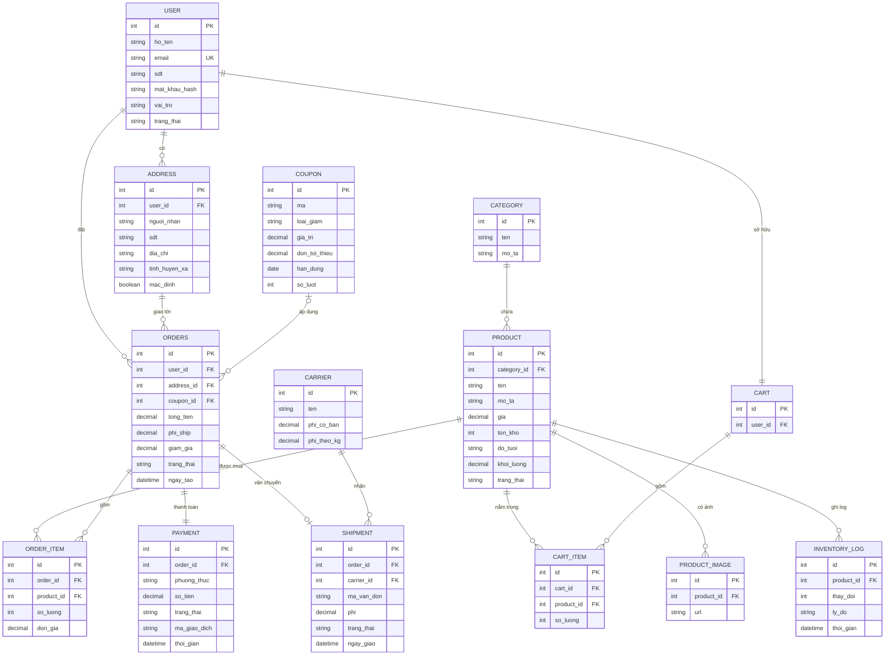

# ERD (14 bảng)

> **Phụ trách:** Trần Vinh Quang  
> **Trạng thái:** 🟠 Chờ duyệt
> **Hạn:** —

<!-- huong-dan:start -->
> 💡 Bảng 14 thực thể bên dưới là **gốc** từ kế hoạch; bổ sung kiểu dữ liệu, PK, FK, ràng buộc. Bảng đơn hàng đặt tên `ORDERS` vì từ khóa SQL; `USER` cũng là từ khóa ở một số hệ quản trị – nếu đổi tên phải báo nhóm trưởng.
> Bản nháp Mermaid là **điểm xuất phát** (tên cột đã bỏ dấu, chỉnh lại nếu cần); hãy hoàn thiện rồi vẽ ERD chính thức bằng draw.io và xuất PNG vào `hinh/`. Quan hệ ORDERS–SHIPMENT đang để *0 hoặc 1* vì vận đơn chỉ có sau khi xác nhận đơn – hãy quyết định và ghi lý do.

<!-- huong-dan:end -->

## Sơ đồ ERD

```mermaid
erDiagram
    USER ||--o{ ADDRESS : "có"
    USER ||--o{ ORDERS : "đặt"
    USER ||--|| CART : "sở hữu"
    CATEGORY ||--o{ PRODUCT : "chứa"
    PRODUCT ||--o{ PRODUCT_IMAGE : "có ảnh"
    PRODUCT ||--o{ CART_ITEM : "nằm trong"
    PRODUCT ||--o{ ORDER_ITEM : "được mua"
    PRODUCT ||--o{ INVENTORY_LOG : "ghi log"
    CART ||--o{ CART_ITEM : "gồm"
    ADDRESS ||--o{ ORDERS : "giao tới"
    COUPON |o--o{ ORDERS : "áp dụng"
    ORDERS ||--o{ ORDER_ITEM : "gồm"
    ORDERS ||--|| PAYMENT : "thanh toán"
    ORDERS ||--o| SHIPMENT : "vận chuyển"
    CARRIER ||--o{ SHIPMENT : "nhận"

    USER {
        int id PK "AUTO_INCREMENT"
        varchar(100) ho_ten "NOT NULL"
        varchar(150) email UK "NOT NULL"
        varchar(15) sdt "NULL được"
        varchar(255) mat_khau_hash "NOT NULL, lưu băm"
        varchar(20) vai_tro "CUSTOMER/STAFF/ADMIN, mặc định CUSTOMER"
        varchar(20) trang_thai "ACTIVE/LOCKED, mặc định ACTIVE"
        datetime ngay_tao "DEFAULT hiện tại"
    }
    ADDRESS {
        int id PK "AUTO_INCREMENT"
        int user_id FK "NOT NULL, ON DELETE CASCADE"
        varchar(100) nguoi_nhan "NOT NULL"
        varchar(15) sdt "NOT NULL"
        varchar(255) dia_chi "NOT NULL, số nhà và đường"
        varchar(150) tinh_huyen_xa "NOT NULL"
        boolean mac_dinh "DEFAULT false, tối đa 1 địa chỉ mặc định/user"
    }
    CATEGORY {
        int id PK "AUTO_INCREMENT"
        varchar(100) ten UK "NOT NULL"
        text mo_ta "NULL được"
    }
    PRODUCT {
        int id PK "AUTO_INCREMENT"
        int category_id FK "NOT NULL"
        varchar(200) ten "NOT NULL"
        text mo_ta "NULL được"
        decimal gia "DECIMAL(12,2), NOT NULL, >= 0"
        int ton_kho "NOT NULL, >= 0, DEFAULT 0"
        varchar(20) do_tuoi "vd 3+, 6+"
        decimal khoi_luong "DECIMAL(8,2) kg, > 0, tính phí ship"
        varchar(20) trang_thai "ACTIVE/HIDDEN/OUT_OF_STOCK"
    }
    PRODUCT_IMAGE {
        int id PK "AUTO_INCREMENT"
        int product_id FK "NOT NULL, ON DELETE CASCADE"
        varchar(500) url "NOT NULL"
    }
    CART {
        int id PK "AUTO_INCREMENT"
        int user_id FK, UK "NOT NULL, 1 user = 1 giỏ"
    }
    CART_ITEM {
        int id PK "AUTO_INCREMENT"
        int cart_id FK "NOT NULL, ON DELETE CASCADE"
        int product_id FK "NOT NULL, UNIQUE cùng cart_id"
        int so_luong "NOT NULL, > 0"
    }
    ORDERS {
        int id PK "AUTO_INCREMENT"
        int user_id FK "NOT NULL (BR1 phải đăng nhập)"
        int address_id FK "NOT NULL"
        int coupon_id FK "NULL được, tối đa 1 mã (BR5)"
        decimal tong_tien "DECIMAL(12,2), >= 0"
        decimal phi_ship "DECIMAL(12,2), 0 nếu từ 500.000đ (BR4)"
        decimal giam_gia "DECIMAL(12,2), DEFAULT 0"
        varchar(20) trang_thai "PENDING/CONFIRMED/PACKING/SHIPPING/DELIVERED/CANCELLED/FAILED"
        datetime ngay_tao "DEFAULT hiện tại"
    }
    ORDER_ITEM {
        int id PK "AUTO_INCREMENT"
        int order_id FK "NOT NULL, ON DELETE CASCADE"
        int product_id FK "NOT NULL"
        int so_luong "NOT NULL, > 0"
        decimal don_gia "DECIMAL(12,2), giá tại lúc mua (BR3)"
    }
    PAYMENT {
        int id PK "AUTO_INCREMENT"
        int order_id FK, UK "NOT NULL, 1 đơn = 1 thanh toán"
        varchar(20) phuong_thuc "COD/BANK_TRANSFER/GATEWAY (BR6)"
        decimal so_tien "DECIMAL(12,2), >= 0"
        varchar(20) trang_thai "UNPAID/PAID/REFUNDED/FAILED"
        varchar(100) ma_giao_dich "NULL với COD"
        datetime thoi_gian "NULL đến khi thanh toán"
    }
    SHIPMENT {
        int id PK "AUTO_INCREMENT"
        int order_id FK, UK "NOT NULL, 0..1 vận đơn / đơn"
        int carrier_id FK "NOT NULL"
        varchar(50) ma_van_don UK "NOT NULL"
        decimal phi "DECIMAL(12,2), >= 0"
        varchar(20) trang_thai "CREATED/PICKED_UP/IN_TRANSIT/DELIVERED/FAILED/RETURNED"
        date ngay_giao "NULL đến khi giao xong"
    }
    CARRIER {
        int id PK "AUTO_INCREMENT"
        varchar(100) ten UK "NOT NULL"
        decimal phi_co_ban "DECIMAL(12,2), >= 0"
        decimal phi_theo_kg "DECIMAL(12,2), >= 0"
    }
    COUPON {
        int id PK "AUTO_INCREMENT"
        varchar(30) ma UK "NOT NULL, viết hoa"
        varchar(10) loai_giam "PERCENT/AMOUNT"
        decimal gia_tri "DECIMAL(12,2), > 0"
        decimal don_toi_thieu "DECIMAL(12,2), DEFAULT 0"
        date han_dung "NOT NULL"
        int so_luot "NOT NULL, >= 0, giảm dần khi dùng"
    }
    INVENTORY_LOG {
        int id PK "AUTO_INCREMENT"
        int product_id FK "NOT NULL"
        int thay_doi "NOT NULL, âm = xuất, dương = nhập"
        varchar(200) ly_do "vd ORDER_PLACED, ORDER_CANCELLED, RESTOCK"
        datetime thoi_gian "DEFAULT hiện tại"
    }
```

| Bảng | Thuộc tính chính | Quan hệ |
| --- | --- | --- |
| USER | id, ho_ten, email, sdt, mat_khau_hash, vai_tro, trang_thai, ngay_tao | 1–N ADDRESS, ORDERS; 1–1 CART |
| ADDRESS | id, user_id, nguoi_nhan, sdt, dia_chi, tinh_huyen_xa, mac_dinh | N–1 USER; 1–N ORDERS |
| CATEGORY | id, ten, mo_ta | 1–N PRODUCT |
| PRODUCT | id, category_id, ten, mo_ta, gia, ton_kho, do_tuoi, khoi_luong, trang_thai | N–1 CATEGORY; 1–N PRODUCT_IMAGE, CART_ITEM, ORDER_ITEM, INVENTORY_LOG |
| PRODUCT_IMAGE | id, product_id, url | N–1 PRODUCT |
| CART | id, user_id | 1–1 USER; 1–N CART_ITEM |
| CART_ITEM | id, cart_id, product_id, so_luong | N–1 CART, PRODUCT |
| ORDERS | id, user_id, address_id, coupon_id, tong_tien, phi_ship, giam_gia, trang_thai, ngay_tao | N–1 USER, ADDRESS; N–0..1 COUPON (không bắt buộc dùng mã); 1–N ORDER_ITEM; 1–1 PAYMENT; 1–0..1 SHIPMENT (chỉ có sau khi xác nhận đơn) |
| ORDER_ITEM | id, order_id, product_id, so_luong, don_gia | N–1 ORDERS, PRODUCT |
| PAYMENT | id, order_id, phuong_thuc, so_tien, trang_thai, ma_giao_dich, thoi_gian | 1–1 ORDERS |
| SHIPMENT | id, order_id, carrier_id, ma_van_don, phi, trang_thai, ngay_giao | 0..1–1 ORDERS (mỗi vận đơn thuộc đúng 1 đơn); N–1 CARRIER |
| CARRIER | id, ten, phi_co_ban, phi_theo_kg | 1–N SHIPMENT |
| COUPON | id, ma, loai_giam, gia_tri, don_toi_thieu, han_dung, so_luot | 1–N ORDERS (0..1 mã mỗi đơn) |
| INVENTORY_LOG | id, product_id, thay_doi, ly_do, thoi_gian | N–1 PRODUCT |

## 3 quyết định thiết kế

1. Tách ORDER_ITEM khỏi ORDERS: một đơn có nhiều sản phẩm, nếu gộp vào ORDERS sẽ phải lặp cột hoặc nhét nhiều giá trị vào một ô, vi phạm chuẩn hóa. Tách ra thì mỗi dòng ORDER_ITEM là một sản phẩm trong đơn (quan hệ 1–N), số sản phẩm tùy ý và dễ thống kê.

2. Lưu đơn giá tại thời điểm mua (ORDER_ITEM.don_gia): giá trong PRODUCT có thể đổi, nếu lấy giá từ PRODUCT thì đơn cũ sẽ đổi theo và sai doanh thu. Vì vậy khi đặt hàng, hệ thống sao chép giá hiện tại vào don_gia và giữ cố định (BR3).

3. Tách PAYMENT và SHIPMENT khỏi ORDERS: thanh toán và vận chuyển là hai nghiệp vụ riêng, có thuộc tính và trạng thái riêng. Gộp vào ORDERS sẽ nhiều cột để trống (đơn COD không có mã giao dịch, đơn chưa xác nhận chưa có vận đơn). Tách ra thể hiện đúng quan hệ ORDERS–PAYMENT 1–1 và ORDERS–SHIPMENT 1–0..1.

## Luồng Giỏ hàng → Đơn hàng → Vận chuyển trên ERD

1. Giỏ hàng: USER có 1 CART (1–1), mỗi sản phẩm thêm vào là một CART_ITEM (kiểm tra PRODUCT.ton_kho).
2. Đặt hàng: chọn ADDRESS, có thể dùng COUPON. Tạo ORDERS (PENDING), sao chép từng CART_ITEM thành ORDER_ITEM với don_gia = giá hiện tại, tính tong_tien = tổng(so_luong × don_gia) + phi_ship − giam_gia. Trừ ton_kho, ghi INVENTORY_LOG (số âm), giảm COUPON.so_luot, xóa CART_ITEM đã đặt.
3. Thanh toán: tạo PAYMENT (1–1 với đơn). Chuyển khoản hoặc cổng mô phỏng thì PAID khi thành công, COD thì UNPAID đến khi giao xong.
4. Xác nhận và đóng gói: ORDERS chuyển CONFIRMED rồi PACKING. Hủy được khi chưa đóng gói (CANCELLED), lúc đó cộng lại ton_kho và ghi INVENTORY_LOG (số dương).
5. Vận chuyển: tạo SHIPMENT (carrier_id, ma_van_don, phi tính từ CARRIER), ORDERS chuyển SHIPPING.
6. Kết thúc: giao thành công thì SHIPMENT và ORDERS thành DELIVERED, PAYMENT thành PAID (đơn COD). Giao thất bại thì SHIPMENT thành FAILED, hoàn hàng về kho (cộng ton_kho, ghi INVENTORY_LOG).

Chuỗi bảng: USER → CART → CART_ITEM → ORDERS → ORDER_ITEM → PAYMENT → SHIPMENT → CARRIER.
